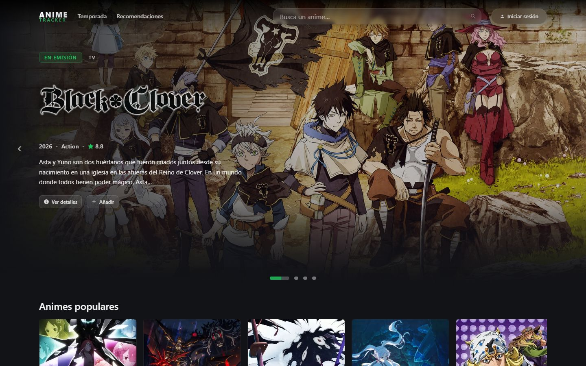
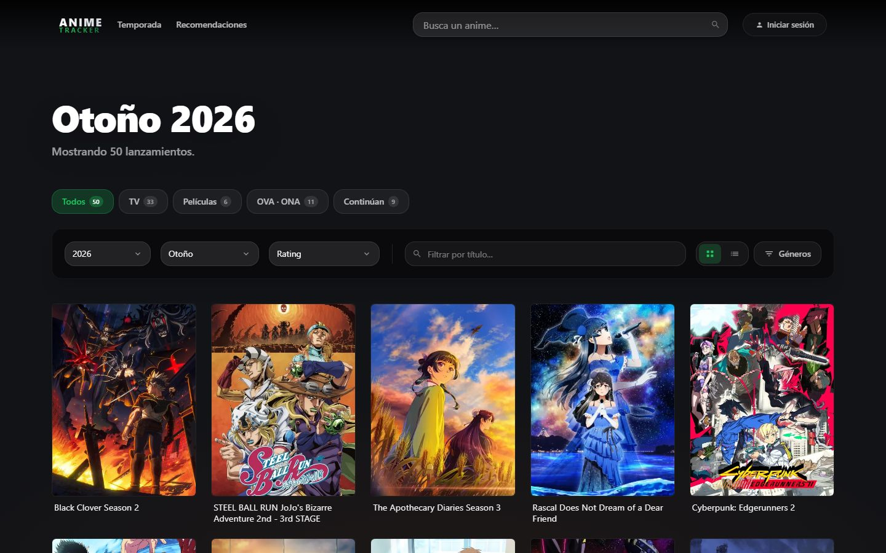
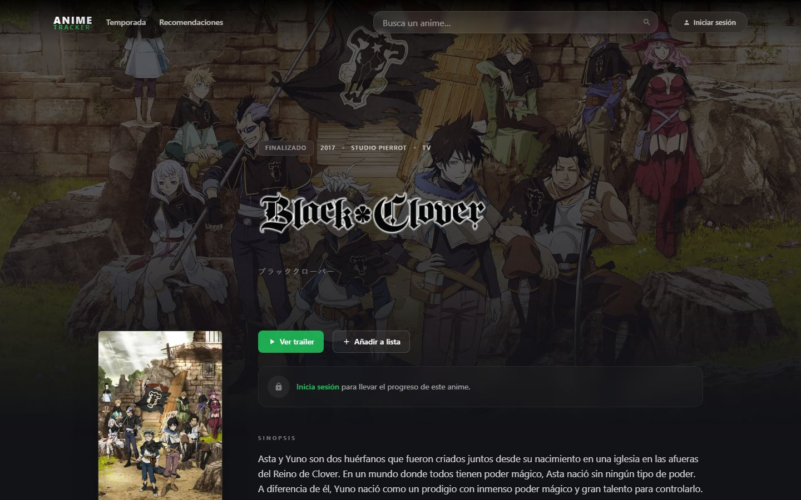
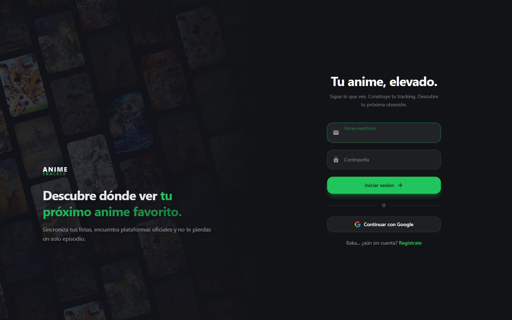

# Anime Tracker

> Discover, track and follow currently airing anime, and see **where to stream each show legally** (Crunchyroll, Netflix, Prime Video, Max, Disney+ and more) — a JustWatch-style catalogue built exclusively for anime.

<p align="left">
  
  
  
  
  
  
  
</p>

---

## Structure

A monorepo of two independent projects, each with its own `package.json` (no workspace manager).

| Folder | What it is | Stack | Deployed on |
|---|---|---|---|
| `anime-availability-api/` | REST API (`/v1`) that aggregates anime metadata, airing schedules and streaming availability from several sources. | Express 5 · TypeScript · Zod · Upstash Redis · Supabase | Render |
| `anime-tracker-ui/` | Web app: discovery, search, tracking, lists, calendar and notifications. | Next.js 16 (App Router) · React 19 · Tailwind CSS v4 · Framer Motion · Supabase SSR | Vercel |
| `openspec/` | Spec-driven design artifacts (proposals, specs, designs, tasks). | Markdown | — |

Authentication, lists and tracking data live in Supabase, protected by row-level security.

---

## Features

### Discovery
- **Home** with a rotating spotlight hero and shelves of trending, popular and currently airing titles.
- **Seasonal catalogue** (`/season`) with an archive of past seasons, filters and pagination.
- **Search overlay** with debounced queries, rendered in a portal so it escapes layout boundaries.
- **Anime detail pages** (`/anime/[id]`) with synopsis, ratings, metadata, artwork gallery and where to watch.

### Streaming availability
- Per-title provider badges, resolved from **TMDB watch providers** and the **Streaming Availability API (RapidAPI)**.
- Verdicts are stored in Supabase and only persisted when **every applicable source answered**, so an exhausted quota is never recorded as "no legal stream".
- A **RapidAPI budget guard** (`quotaGuard.ts`) enforces a hard daily ceiling on the metered endpoint; batch lookups never spend from it.

### Metadata sources
- **AniList** (primary), **MyAnimeList**, **Kitsu**, **Shikimori**, **TMDB** and **fanart.tv** for titles, scores, images and artwork.
- **animeSchedule** for airing times and broadcast delays.
- Hybrid cache (in-memory plus optional Upstash Redis) with per-resource TTLs, and a circuit breaker for failing upstreams.

### Personal tracking (signed in)
- **Supabase auth** with email/password and Google OAuth.
- **Tracking statuses**: plan to watch, watching, completed, on hold, dropped.
- **Lists** (`/lists`): custom collections (`/lists/[id]`) and **favourites** (`/lists/favorites`).
- **Recommendations** (`/recommendations`) based on what you have watched.
- **Airing calendar** (`/calendar`): a week view of the episodes you follow, filterable by status. The last good week is cached locally, so a failed fetch still shows the schedule, and it is cleared on sign-out.
- **Notification bell** for new and upcoming episodes of the shows you are watching.
- **Delayed-episode badges** in the calendar and the bell when a broadcast is postponed.

### Accessibility and UX
- Keyboard navigation, including arrow-key galleries and carousels.
- Focus traps, `Escape` to close and focus restoration in modals.
- ARIA labels on icon-only controls and screen-reader text for state shown only visually.
- Reduced-motion support and WCAG-minded contrast on the dark theme.
- Responsive, mobile-first layouts with touch-friendly carousels.

---

## Local setup

Requires Node.js 20+ and a Supabase project.

```bash
# 1. Clone
git clone https://github.com/fer-araujo/anime-tracker.git
cd anime-tracker

# 2. API
cd anime-availability-api
npm install
cp .env.example .env      # fill in the values below
npm run dev

# 3. Web app (new terminal)
cd anime-tracker-ui
npm install
cp .env.example .env.local
npm run dev
```

### Environment variables

Names only; never commit real values.

**`anime-availability-api/.env`** (template: `.env.example`)

| Variable | Purpose |
|---|---|
| `TMDB_KEY` | TMDB API key (images, watch providers). |
| `MAL_CLIENT_ID` | MyAnimeList API client id. |
| `ANIMESCHEDULE_TOKEN` | animeSchedule token (timetables, delays, calendar and notifications). |
| `FANART_TV_KEY` | fanart.tv key (title logos and backdrops). |
| `STREAMING_AVAILABILITY_KEY` | RapidAPI Streaming Availability key. `STREAMING_AVAIL_KEY` and `RAPIDAPI_KEY` are read as fallbacks. |
| `RAPIDAPI_DAILY_LIMIT` | Daily cap on RapidAPI calls, so the monthly quota is never exhausted. |
| `SUPABASE_URL`, `SUPABASE_SERVICE_KEY` | Server-side Supabase access (stored provider verdicts). |
| `REDIS_URL`, `REDIS_TOKEN` | Upstash Redis cache (optional; falls back to memory). |
| `ALLOWED_ORIGINS` | Comma-separated CORS origins for the web app. |
| `PORT`, `LOG_LEVEL` | Server port and log verbosity. |
| `ANILIST_URL`, `DEFAULT_COUNTRY`, `PROVIDER_CACHE_DAYS` | Optional overrides. |
| `CACHE_TTL_*`, `DISABLE_CIRCUIT_BREAKER` | Optional cache and resilience tuning. |

`RENDER_EXTERNAL_URL` is set by Render itself and drives the keep-awake self-ping.

**`anime-tracker-ui/.env.local`** (template: `.env.example`)

| Variable | Purpose |
|---|---|
| `NEXT_PUBLIC_API_URL` | Base URL of the API above. |
| `NEXT_PUBLIC_SUPABASE_URL`, `NEXT_PUBLIC_SUPABASE_ANON_KEY` | Supabase project for auth and user data. |
| `NEXT_PUBLIC_SITE_URL` | Public site URL used for auth redirects (falls back to the current origin). |

### Verification

Both projects use Vitest. Run from each project folder, not from the repo root:

```bash
npx tsc --noEmit && npx vitest run
```

## Preview

Captured from production at 1440×900. Screens that need a session (calendar, lists, notifications) are not shown yet.

**Home** — the spotlight hero and shelves for popular, airing today, coming soon and trending this season.



**Season** — the current season with format tabs, year/season/sort filters, genre filter and a grid/list toggle.



**Anime details** — cinematic hero, trailer, list and tracking actions, synopsis and where to watch.



**Sign in** — email and password or Google, over a wall of current posters.



## License
Released under the MIT License.
Feel free to use, fork and expand — just credit the authors.
